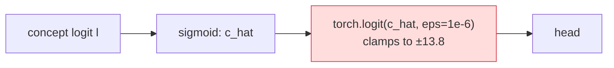
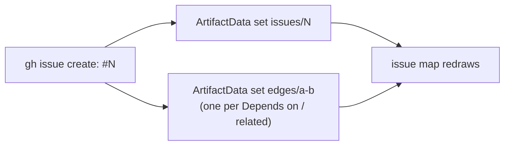

# Filing issues

Rules for the GitHub issues that AI coding sessions (and people) open in this repository.
`CLAUDE.md` says *when* to file one: every problem found along the way that the current task
doesn't fix. This page says *how*. A good issue lets a fresh session, with no memory of the
conversation that found the problem, reproduce it and decide on a fix without asking anyone.

## Before filing

1. **Reproduce it.** Run the reproduction you are about to paste and copy its real output. If you
   could not run it (needs real data, a GPU, a Modal volume, network), say so explicitly:
   *"Not run: needs the CUB images."* Never present a suspected problem as a confirmed one.
2. **Check it is not already filed.** Search open *and* closed issues with a few different
   terms (the component name, the error message, the config key):
   ```bash
   gh issue list --state all --search "logit clamp"
   gh issue list --state all --search "in:title git_commit"
   ```
   If one exists, comment on it with your new evidence (another affected run, a smaller repro, a
   second code path) instead of opening a duplicate. If a closed issue covers it and the problem is
   back, open a new one that links the old one ("Regression of #N").
3. **Check it is out of scope.** If the fix belongs in the change you are making, make it there
   and mention it in the PR. File an issue only for what you are leaving unfixed.
4. **One problem per issue.** Two causes or two fixes mean two issues that link each other.

## Title

State the symptom and the component, specific enough to tell it apart from every other issue
without opening it. Aim for under ~90 characters, no trailing period, no `[Bug]`-style prefixes
(labels do that).

| Good | Bad |
|---|---|
| `logits generation clamps concept logits at ±13.8: head sees saturated values` | `Bug in generation` |
| `Modal runs record git_commit: null (no code provenance for cloud results)` | `git_commit issue` |
| `concept_alignment evaluator crashes on bags when filtering removes every concept` | `Crash!!` |

## Abstract and key facts

Every issue starts with two things, before any heading:

1. **An abstract.** One or two sentences, at most 40 words. It says what is wrong, where, and
   what it does to the study. A reader who reads only the abstract knows if the issue matters
   to them.
2. **A key-facts table.** One row, always the same four columns. Readers scan these tables to
   sort and filter issues without reading the body.

```markdown
> **Abstract:** `generation: logits` clamps concept logits at ±13.8 before the head.
> Above that value the task loss has no gradient, so joint training differs from Koh et al.

| Type | Component | Changes results? | Status |
|---|---|---|---|
| bug | `generation: logits` | yes: Koh joint and sequential anchors | reproduced |
```

- **Type** is the type label (`bug`, `enhancement`, `documentation`, `question`).
- **Component** is the registered name or the file (`training: joint`, `results.py`).
- **Changes results?** is `no` or `yes: <which runs>`. It is the short form of
  *Effect on existing results*.
- **Status** is `reproduced`, `not run: <reason>` or `suspected`.

## Visuals first

Show it before you explain it. A diagram or a table is easier to read than a paragraph with
the same content.

| To show | Use |
|---|---|
| where the problem sits in the pipeline, or a data flow | a Mermaid `flowchart`; mark the broken step |
| expected vs actual, before vs after a fix | a two-column table |
| numbers (affected runs, metric differences) | a table with the source of each number |
| an order of events (caching, claiming, retries) | a Mermaid `sequenceDiagram` |

GitHub renders Mermaid in issues. Example for the issue above:

````markdown

````

Rules for visuals:

- Put the visual directly under *What goes wrong*. Put text after it, not before it.
- Keep a diagram small: about 10 nodes or fewer. Use the real stage and component names.
- Mark only the part that is wrong. Use the red `bad` class from the example.
- A visual does not replace the reproduction. Both are required.
- Do not attach screenshots or link external image hosts. Show numbers as a table.

## Writing style: Simplified Technical English

Write the issue text in the style of
[Simplified Technical English](https://www.asd-ste100.org/) (ASD-STE100). Technical terms
are fine. The grammar around them stays simple. This keeps issues short, and the important
facts are easy to find.

| Rule | Write | Do not write |
|---|---|---|
| One idea per sentence, at most 20 words. | `represent` clamps the logit. The head sees ±13.8. | `represent`, which is called by the head, ends up clamping the logit so that... |
| Active voice, present tense. | `_git_commit` returns `None` on Modal. | `None` is being returned by... |
| One name for one thing. Use the code name, always the same one. | `run_id` (every time) | `run_id`, then "run hash", then "experiment ID" |
| Facts, no filler or hedging. | Cause unknown. | It seems like there might possibly be... |
| Steps as a numbered list, one action per step, imperative. | 1. Run `cbm-eval run ...`. 2. Open `results.jsonl`. | First you'd want to run..., and after that... |
| At most 3 sentences per paragraph; otherwise use a list. | (bullets) | (a wall of text) |

Put long explanations, full tracebacks and reasoning in a collapsed
`<details><summary>Details</summary> ... </details>` block. The visible part of the issue stays
short.

## Body: problems (bugs, reproducibility gaps, cache-key holes, wrong docs)

Use this layout, in this order. Leave out a section only when it says "if known".

```markdown
> **Abstract:** <at most 40 words: what is wrong, where, effect on the study.>

| Type | Component | Changes results? | Status |
|---|---|---|---|
| bug | `<name>` | no / yes: <runs> | reproduced / not run: <reason> / suspected |

### What goes wrong
A diagram or an expected-vs-actual table first. Then at most 3 short sentences: why it
matters for the study (wrong metric, unfair comparison, crash, stale cache, misleading doc).

### Reproduction
The smallest config or snippet that shows it, on the synthetic dataset and `toy` backbone
whenever possible, followed by its actual output. Paste the YAML inline, not just a path.

### Where / cause
`src/cbm_eval/<file>.py:<line>` and, if known, why it happens. Say "Cause unknown" rather
than guessing; label guesses as guesses.

### Possible fix (if known)
A sketch, not a patch. Respect the reproducibility invariants: prefer a new kwarg or a new
registered variant whose default keeps today's behaviour.

### Effect on existing results
Required. Either "None: metadata only / crash only / docs only", or which run ids, anchors,
ablations or results files change if the fix lands, and whether they need `--force` or a new
results file.
```

## Body: tasks (features, refactors, tracker items)

Tasks someone else may pick up follow the layout of the `oss-readiness` issues (e.g. #43):

```markdown
> **Abstract:** <at most 40 words: what the task adds and why.>

| Type | Component | Changes results? | Status |
|---|---|---|---|
| enhancement | `<name>` | no / yes: <runs> | open / needs-decision |

<A diagram of where the change fits, if it touches more than one stage. Then at most 3 sentences.>

### Scope
- [ ] concrete, checkable items; mark items that need the owner with **Owner input:**

### Done when
An observable condition (a test passes, a page builds, a command prints X).

### Depends on
#N, #M — or "Nothing."

### Shared files (possible merge conflicts)
Files other open tasks also touch — or "None."

### Effect on existing results
Same rule as for problems.
```

If the task belongs to a tracker (e.g. #12), add a **Picking this up** section like #43's and
attach it as a sub-issue (see [Commands](#commands)).

## Evidence and accuracy

- **Verified vs suspected.** Everything stated as fact must have been observed in this session:
  run output, a line of code you read, a result row you loaded. Mark everything else
  ("Probably also affects `independent` training; not checked").
- **Real numbers only.** Quote numbers from actual output, with the run id, seed and file they
  came from (`77e70c011f`, seed 1, `results/cub_koh2020.jsonl`). Never round, estimate or invent a
  number to make the issue sound concrete.
- **Code references point at `main`.** Use repo-relative `path:line` as of the current `main`
  commit. If the code exists only on a branch or worktree, name the branch.
- **Short output.** Paste the relevant lines of a traceback or log (the last frame and the error,
  not 200 lines). Put longer output in a collapsed `<details>` block.
- **Nothing private or machine-specific.** No API keys, tokens, `.env` contents, e-mail
  addresses, or absolute local paths (`/Users/...`); use repo-relative paths and `$CACHE_DIR`.
  Don't paste dataset images or licensed data.

## Labels

Use only labels that already exist (`gh label list`); never create new ones.

- **Exactly one type label:** `bug` (behaviour is wrong, or code and docs disagree),
  `enhancement` (new capability), `documentation` (docs only, code is right), or `question`.
- **`needs-decision`** when the fix requires a choice only the owner can make (a default, a
  dependency, a licence, an API). Say in the body exactly what needs deciding and list the options.
- **Priority / effort labels** (`p1-blocker` … `p4-contributors`, `oss-readiness`) only when
  filing into that tracker.
- **`in-progress`** is for claiming work, not for filing. Don't add it to an issue you only opened.
- Don't use `good first issue` or `help wanted`; the owner decides those.

## Things a session must not do

- Assign people, set milestones or projects, or @-mention anyone.
- Close, reopen, retitle or edit the body of an issue it did not open in this session. Comment
  instead. Closing happens through `Closes #N` in a merged PR.
- File speculative wish lists, style nits, or "consider refactoring X" with no concrete problem.
- Propose changing a default or a variant's behaviour in place without spelling out the
  results impact. That is what silently invalidates `run_id`s.
- Open more than one issue for the same root cause because it shows up in several places; list
  every place in one issue.

## After filing

- Link the issue (`#N` plus URL) in your reply to the user, and in the commit or PR where the
  problem came up.
- If the issue belongs to a tracker, attach it as a sub-issue and add it to the tracker's checklist.
- If you later learn more (cause found, wider impact, repro shrunk), comment on the issue. Don't
  leave it only in the conversation.
- Update the issue map (next section).

## Update the issue map

The [issue map](https://claude.ai/artifact/GA67DGJo8uYoJcaC3aFnFy) shows every open issue as a
box, grouped by theme, with arrows for dependencies. The page reads its data from its own
database. Do not republish the page. Write database documents with the `ArtifactData` tool
(load it with `ToolSearch`), and the page redraws itself.



| When | Write |
|---|---|
| You open issue #N | `set` `issues/N`, plus one `edges/<a>-<b>` per link. Use one `batch` call. |
| An issue closes | `update` `issues/N` with `{"state": "closed"}`. The page hides it and its arrows. |
| An abstract, label or dependency changes | `update` `issues/N`, or `set`/`delete` the edge |
| A summary note is out of date | `update` `findings/<id>` (`{order, text}`) |
| Always, with any of the above | `update` `meta/info` with `{"updated": "<YYYY-MM-DD>"}` |

Read a document before you change it, and pass its `version` as `if_version`. A new document
needs no version.

Fields of `issues/N`. Take them from the issue's abstract and key-facts table:

| Field | Value |
|---|---|
| `n` | the issue number (a number) |
| `title` | the GitHub title |
| `short` | a box label, at most 26 characters |
| `abstract` | the issue's abstract, as written |
| `effect` | the *Changes results?* cell, written as a sentence |
| `labels` | the GitHub labels, as a list |
| `cluster` | a theme id from `clusters/`: `release`, `library`, `bugs`, `validation`, `results`, `koh`, `interventions`, `datasets`, `anchors` |
| `section` | the tracker section (`p1` … `p4`, `other`), or leave it out if the issue is not in tracker #12 |
| `state` | `"open"` |
| `slot` | optional; the position inside the theme box. Leave it out to put the issue at the end. |

Fields of `edges/<a>-<b>`: `a` and `b` (numbers, `a` lands first), `k`, and `why` (one sentence
that names the source, e.g. "Listed under Depends on in #38."). `k` is one of:

| `k` | Meaning | Source |
|---|---|---|
| `hard` | `a` must land before `b`; `b` shows as blocked | `b`'s *Depends on* section |
| `soft` | `a` should land first | "merge after", "rebase onto" |
| `rel` | the issues reference each other | a `#N` link in the body |
| `inf` | a link you inferred; nothing in the issues states it | your own analysis; say why |

If no theme fits, leave `cluster` empty. The issue then shows in a "Not yet placed in a theme"
box, and you tell the user. Add a new theme (`clusters/<id>` with `label`, `order`, `col`,
`span`) only when the user agrees.

If `ArtifactData` is not available in your session (CI, or no claude.ai login), say so in your
reply. Do not skip the step without saying so.

## Commands

Write the body to a file and pass it with `--body-file`. Inline `--body "..."` breaks on
backticks, `$` and quotes, which these issues are full of.

```bash
gh issue create --title "<title>" --label bug --body-file /tmp/issue.md

# comment on an existing issue instead of duplicating it
gh issue comment 47 --body-file /tmp/comment.md

# attach #N as a sub-issue of tracker #12 (sub_issue_id is the issue's id, not its number)
gh api repos/{owner}/{repo}/issues/12/sub_issues \
  -F sub_issue_id="$(gh api repos/{owner}/{repo}/issues/N --jq .id)"
```

## Checklist

- [ ] Reproduced, or explicitly marked as not run and why
- [ ] Searched open and closed issues; no duplicate
- [ ] Title names the symptom and the component
- [ ] Starts with an abstract (at most 40 words) and the key-facts table
- [ ] A diagram or table under *What goes wrong*; long text and tracebacks in `<details>`
- [ ] Simplified Technical English: sentences of at most 20 words, active voice, one name per thing
- [ ] All required sections, including **Effect on existing results**
- [ ] `path:line` references against `main`; numbers come from real output with their source
- [ ] One type label, existing labels only; `needs-decision` if the owner must choose
- [ ] No secrets, local paths or private data
- [ ] Linked in the reply and in the related commit or PR
- [ ] Issue map updated: `issues/N`, its edges and `meta/info.updated`
